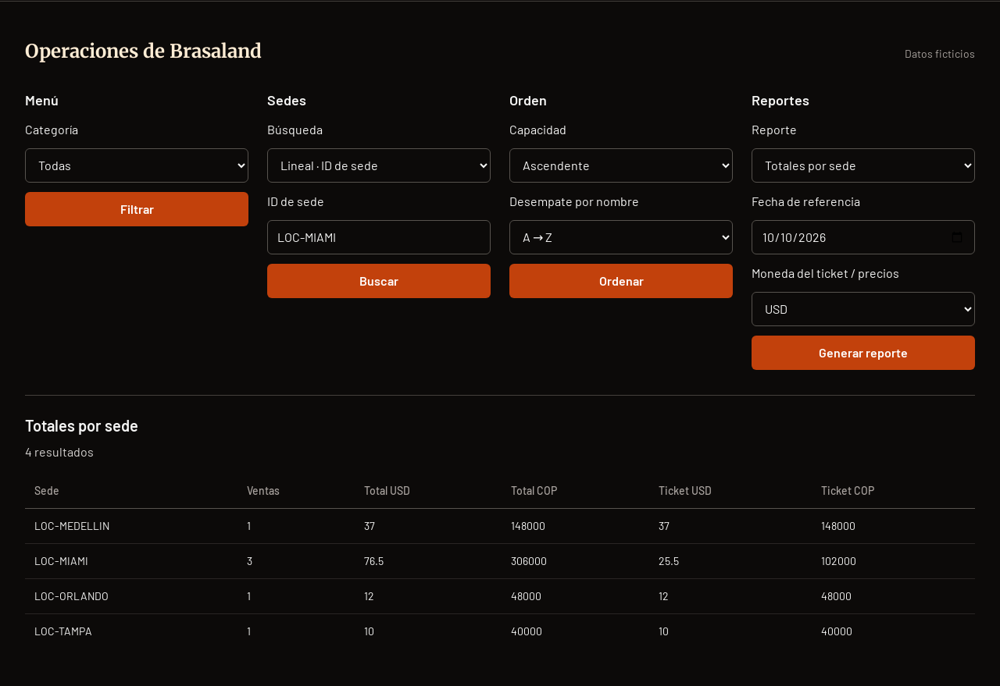
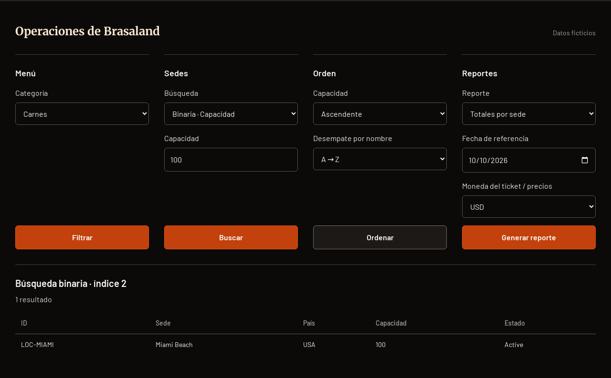
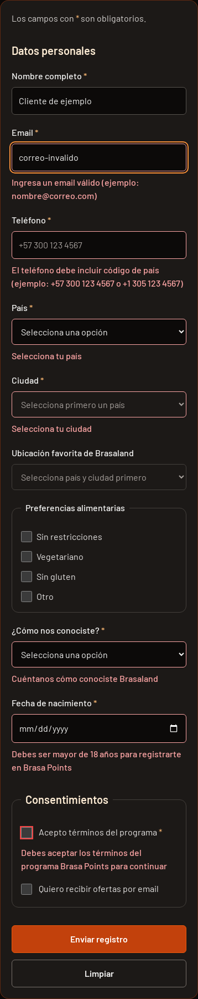
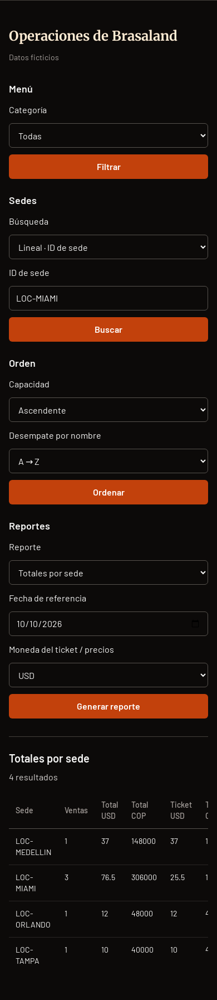
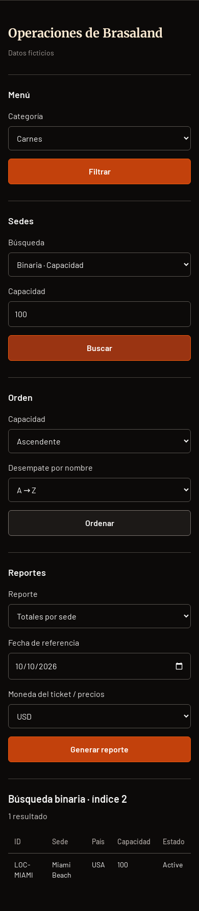

# Contraste y verificación del hito

Rama de corrección: `fix/contraste-validaciones-brasaland`, creada desde `feature/domain-models`. Base del PR: `feature/domain-models`, no `main`.

## Contraste

El fallo reproducido en Brasa Points ocurre al validar: `validation.js` añade `text-stone-900` y permanece el fondo oscuro. El contraste medido era 1.13:1. Se conserva el JavaScript y sus reglas; los selectores compartidos del CSS fuente fijan colores coherentes para cualquier estado.

En Chromium, los controles y botones de Operaciones ya tenían colores al cargar el CSS compilado actual: no se reprodujo el fondo blanco inicial reportado. Sí faltaban `color-scheme: dark`, tratamiento de autofill, estados completos y alineación uniforme. Se corrigieron estas carencias sin reemplazar la página ni sus operaciones.

- Estilo reutilizable `.form-control` y selectores de ambos formularios en `styles.css`: texto claro, fondo oscuro, placeholder atenuado, opciones oscuras, foco naranja y campos deshabilitados legibles. Checkbox/radio conservan dimensiones nativas.
- `:-webkit-autofill` mantiene texto claro y fondo oscuro mediante relleno y sombra interior; el foco conserva anillo naranja. El selector de fecha usa `color-scheme: dark` e indicador nativo visible.
- Botones primarios/secundarios con fondo, borde, hover oscuro, foco visible y estado deshabilitado. Áreas con separación de 32px y bordes; botones alineados en escritorio.
- No se editó CSS compilado manualmente: `npm run build` regenera `dist/styles.css`, que permanece versionado.

| Texto verificado              | Contraste final          |
| ----------------------------- | ------------------------ |
| Valores de campos             | 18.11:1                  |
| Placeholders                  | 7.83:1                   |
| Mensajes de error             | 9.21:1                   |
| Botón primario blanco/naranja | 5.18:1; hover más oscuro |

Se comprobaron valores, opciones, foco, hover, deshabilitados y estado de error en Chromium a 1440px y 390px. El autofill se probó forzando la pseudoclase mediante DevTools: texto y sombra correctos. No se certifica autofill real desde un perfil de Safari ni la apariencia de todos los selectores nativos de cada sistema operativo. Las mediciones cubren estos componentes, no una certificación WCAG completa del sitio.

## Tabla de verificación de la Tarea 2

| ID  | Requisito                             | Antes | Final | Evidencia y cambio                                                                                                                                                                                                                               |
| --- | ------------------------------------- | ----- | ----- | ------------------------------------------------------------------------------------------------------------------------------------------------------------------------------------------------------------------------------------------------ |
| 1   | Interfaces de Brasaland y COP/USD     | ✅    | ✅    | `src/types/models.ts`: Location, MenuItem, SaleTransaction, Customer, Supplier, Employee, Ingredient, StockRecord, Recipe y Price. Se conserva el esquema y su trazabilidad; los campos propuestos se identifican como supuestos.                |
| 2   | Filtrar, ordenar sin mutar y agrupar  | ⚠️    | ✅    | `src/utils/collections.ts`: filtros combinables y órdenes existentes pasan; se añade `groupBy` con Map y arrays nuevos, cubierto por el demo.                                                                                                    |
| 3   | Búsquedas lineal y binaria            | ✅    | ✅    | `src/utils/search.ts`, `src/demo.ts`: vacío, ausente, extremos, singleton y duplicados pasan. No se reescriben.                                                                                                                                  |
| 4   | Agregaciones y reportes requeridos    | ✅    | ✅    | `src/utils/transformations.ts`: countByCategory, sumBy, averageBy, maxBy, minBy, calculateLocationSalesTotals, calculateWeeklyFloridaSales y findHighestMonthlyTicket. Vacíos documentados en ambos README y probados.                           |
| 5   | Validadores de todas las entidades    | ⚠️    | ✅    | `src/utils/validations.ts`: se añaden cliente/proveedor/empleado/ingrediente/stock/receta/desperdicio; campos, números finitos, estructura parcial y fechas válidas/coherentes. No lanzan con null/undefined/{}. Supuestos explícitos en README. |
| 6   | Typecheck strict y build documentados | ✅    | ✅    | `tsconfig.json`: strict true; `package.json`: typecheck = tsc --noEmit, build = tsc && npm run build:css. Tabla de comandos en README.es.md.                                                                                                     |
| 7   | Calidad y pureza                      | ✅    | ✅    | Revisión de ocho TS: cero any, @ts-ignore, @ts-nocheck o var; utils sin Date.now ni new Date sin argumentos. Date con argumentos transforma datos explícitos, no lee reloj. Nombres y responsabilidades conservados.                             |
| 8   | Demo con casos borde                  | ✅    | ✅    | `src/demo.ts`: pasa de 47 a 60 casos, incluyendo agrupación, nuevas entidades, null, campos parciales, negativos/no finitos y intervalos invertidos.                                                                                             |
| 9   | JS del formulario independiente       | ⚠️    | ✅    | `validation.js` sin cambios frente a la base. Ambos README señalan `src/utils/validations.ts` como reglas de datos TypeScript, separadas de edad/contacto/consentimiento del registro.                                                           |
| 10  | README completo                       | ⚠️    | ✅    | README.md y README.es.md: npm install, typecheck, build, demo, http-server 3000, estructura, tabla contexto → campo y supuestos. Se actualizan agrupación y número de casos.                                                                     |

El contexto se leyó completo. No define esquemas ni reglas numéricas formales: los modelos y restricciones heredadas/nuevas son supuestos técnicos documentados. Los nuevos validadores no imponen edad del cliente, fórmula de puntos, máximos, unidades, orden del histórico ni restricciones laborales. Las referencias entre IDs no se resuelven contra una base de datos.

## Resultados

```text
npm run typecheck: exit 0, sin errores
npm run build: exit 0, TypeScript ES + Tailwind CSS
npm run demo: exit 0, 60 pruebas correctas
npx http-server . -p 3000 -a 0.0.0.0: servidor operativo
Chromium escritorio/móvil: sin errores de consola ni imports fallidos
```

La regresión de navegador comprueba filtros con/sin resultados, búsquedas lineal/binaria, multicampo y todos los reportes. No hay desbordamiento horizontal de página; la tabla conserva scroll local cuando lo necesita. El primer intento de servidor 3000 encontró puerto ocupado; posteriormente se inició el comando exacto en 3000 y se repitieron con éxito las pruebas. Las advertencias existentes de Browserslist no bloquean el build.

## Capturas antes y después

Las capturas previas corresponden a la base, sin simulación ni modificación del CSS. Las posteriores corresponden a esta rama; el formulario muestra un error real generado por su JavaScript.

### Formulario de escritorio


### Operaciones de escritorio




### Formulario móvil




### Operaciones móvil




### Autofill forzado


El archivo no versionado `tall`, preexistente al trabajo, permanece intacto y no se incluye en este PR.
